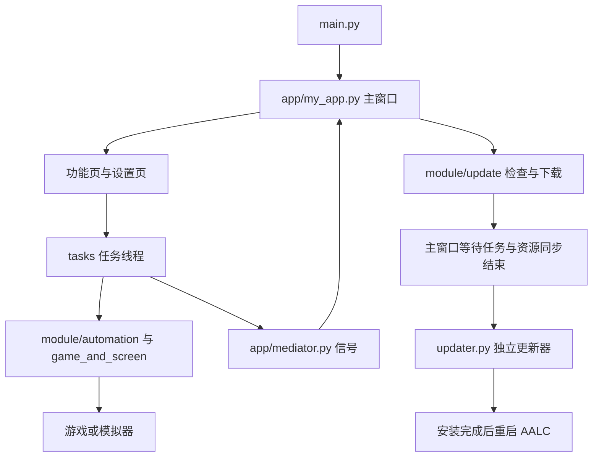

# AALC 项目架构

本文记录当前代码的主要职责、运行流程和主题样式位置。开发环境与命令见[开发指南](develop_guide.md)，界面组件说明见 [UI 组件开发说明](ui_components.md)。下文路径均相对于项目根目录。

## 入口与模块职责

AALC 主程序使用 PySide6、qfluentwidgets 和 qframelesswindow 构建桌面界面，通过任务线程执行游戏自动化。独立更新器使用 Win32 原生窗口，在主程序退出后安装更新。

| 位置 | 职责 |
| --- | --- |
| `main.py` | 正式入口：工作目录、单实例参数转发、提权、打包版本安装锁、Qt 应用和主窗口启动。 |
| `main_dev.py` | 开发入口，提供源码变更检测与重启。 |
| `app/my_app.py` | 主窗口、导航、托盘、主题初始化，以及任务空闲后的更新交接。 |
| `app/*_interface.py`、`app/page_card.py` | 功能页、设置页和任务配置入口。 |
| `app/base_tools.py`、`app/base_combination.py`、`app/card/`、`app/widget/` | 基础控件、组合卡片、弹窗和专用控件。 |
| `app/mediator.py` | 跨页面、任务线程与 UI 之间的信号；共享实例在 `app/__init__.py` 创建。 |
| `tasks/base/script_task_scheme.py`、`tasks/` | 任务编排和执行；按日常、战斗、镜牢、队伍、小工具等功能划分。 |
| `module/automation/`、`module/game_and_screen/`、`module/ocr/` | 截图、图像/文字识别、输入操作、游戏窗口和屏幕管理。 |
| `module/config/` | 配置模型、读写和导入导出；`module/config/__init__.py` 创建共享 `cfg`。 |
| `module/logger/`、`module/hotkey_listener.py`、`module/system_actions.py` | 日志、全局快捷键和任务完成后的系统操作。 |
| `module/update/` | 版本检查、更新下载和独立更新器启动。 |
| `module/resource_sync/`、`app/resource_sync_coordinator.py` | 图片资源同步及其与 UI、任务运行状态的协调。 |
| `utils/` | 路径、图片、文件等辅助功能，以及不依赖 GUI 的共享样式数据。 |
| `assets/`、`i18n/` | 图像模板、图标、音频、配置示例、文档及翻译。 |
| `updater.py`、`update_support.py` | 独立安装流程、进度窗口，以及主程序/更新器共用的安装锁和未完成标记路径。 |
| `main.spec`、`updater.spec`、`tests/` | 主程序与更新器的打包配置，以及自动化回归测试。 |

## 主要运行流程

UI 通过配置和任务入口发起工作，任务通过信号回报进度、结束和提示信息。`app/__init__.py`、`module/config/__init__.py` 等模块有初始化副作用；独立更新器不应为读取样式而导入它们。

## AALC 主体风格与主题文件位置

**主界面控件样式主要存放在 [`app/common/ui_config.py`](../../../app/common/ui_config.py)**；主窗口与更新器共用的基础颜色集中在 [`utils/ui_theme.py`](../../../utils/ui_theme.py)。修改样式时先根据下表定位，避免在界面逻辑中增加重复色值。

| 位置 | 修改内容 |
| --- | --- |
| [`utils/ui_theme.py`](../../../utils/ui_theme.py) | `THEME_COLOR` 品牌色、`MAIN_WINDOW_STYLES` 深浅色窗口背景、`UPDATER_WINDOW_STYLES` 更新器背景/文字/进度条颜色。只包含普通 Python 数据，不导入 Qt 或应用配置。 |
| [`app/common/ui_config.py`](../../../app/common/ui_config.py) | `FONT_FAMILIES` 字体、标题栏、边框、设置卡片、日志栏、导航、星光与公告等 QSS，以及 `get_*_style()` / `get_*_qss()` 获取函数；主窗口背景从共享样式模块导入。 |
| [`app/my_app.py`](../../../app/my_app.py) | 调用 `setThemeColor(THEME_COLOR)`、根据 `theme_mode` 调用 `setTheme()`，并由 `_apply_theme_styles()` 应用主窗口和标题栏样式。 |
| [`app/setting_interface.py`](../../../app/setting_interface.py) | 个性化设置中的主题选择与设置页面自身的样式应用。 |
| [`app/custom_pivot.py`](../../../app/custom_pivot.py)、[`app/widget/custom_segmented_widget.py`](../../../app/widget/custom_segmented_widget.py) | 导航控件的样式应用及指示器绘制；主题色通过 qfluentwidgets 的 `themeColor()` 获取。 |
| [`assets/styles/github-markdown-light.css`](../../styles/github-markdown-light.css)、[`assets/styles/github-markdown-dark.css`](../../styles/github-markdown-dark.css) | 内嵌 Markdown 文档的深浅色 CSS，由 `app/page_card.py` 选择和加载。 |
| [`updater.py`](../../../updater.py) | `_resolve_theme_style()` 选择更新器样式；`UpdateProgressWindow._window_loop()` 创建原生控件、设置字体和布局，并将共享 `#RRGGBB` 色值转为 Win32 `COLORREF`。 |

qfluentwidgets 提供基础 Fluent 控件外观，项目 QSS 在其上补充样式。当前仍有少量局部样式位于具体组件中，例如 `app/announcement_board.py`、`app/base_combination.py` 和 `app/theme_pack_setting_interface.py`；修改对应组件时也需检查其 `setStyleSheet()` 调用。

### 主题选择与依赖边界

- 主程序从 `config.yaml` 的 `theme_mode` 读取 `LIGHT`、`DARK` 或 `AUTO`，由 qfluentwidgets 管理主题和变化通知。
- 独立更新器在进度窗口创建时读取同一配置项。`LIGHT` / `DARK` 直接选用对应样式；`AUTO` 或未读到配置时查询 Windows 的 `AppsUseLightTheme`，系统设置不可读时使用深色。更新器不监听运行中的主题切换。
- 颜色用 `#RRGGBB` 字符串统一保存。Qt 直接使用字符串；更新器在调用 Win32 API 时转换，避免把 RGB 数值直接当作 `COLORREF` 使用。
- `utils/ui_theme.py` 保持无运行时依赖。Qt 专用的字体应用、QSS、`QColor` 和控件操作继续放在 `app/common/ui_config.py` 或对应控件内；更新器不导入该 Qt 模块。

`assets/images/dark/` / `default/` 表示游戏截图识别模板的主题，`assets/app/theme_packs/` 是镜牢主题卡包图片；它们与 AALC 桌面界面的主题样式分别维护。识别规则见[图片识别机制](image_recognition.md)。

## 更新流程与验证

下载与安装分属两个进程：`module/update/download.py` 完成下载，主窗口等待任务空闲并交接给 `updater.py`。更新器校验包和清单、等待主程序退出、获取安装锁、备份并替换文件；失败时按安装状态恢复旧文件或保留未完成标记。具体备份位置和恢复方法见[更新器验证与恢复](develop_guide.md#更新器验证与恢复)。

主题相关修改可运行 `tests/test_update.py` 检查显式/系统主题选择、共享色值及更新器的导入依赖，同时保留安装回归。离线测试不能替代打包后的窗口显示、在线下载和完整更新验收。
